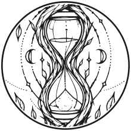

  <picture>
    <source media="(prefers-color-scheme: dark)" srcset="assets/insignia-light.png">
    
  </picture>

  <picture>
    <source media="(prefers-color-scheme: dark)" srcset="assets/marca-light.png">
    
  </picture>

<em>Roots, growth and time.</em>

---

A small workshop for infrastructure and software, built slowly and meant to last.

The mark comes from a tattoo: a tree of life grown around an hourglass. Roots for solid foundations,
branches for what grows on them, and the hourglass as a reminder that good work takes its time.

**How we work**

- **Self-hosted first.** Own the stack, understand every layer.
- **Secure by default.** Least privilege, signed artifacts, no secrets in code.
- **Everything as code.** Reproducible, reviewed and versioned.
- **Automate the boring parts.** Then spend the time on what matters.
